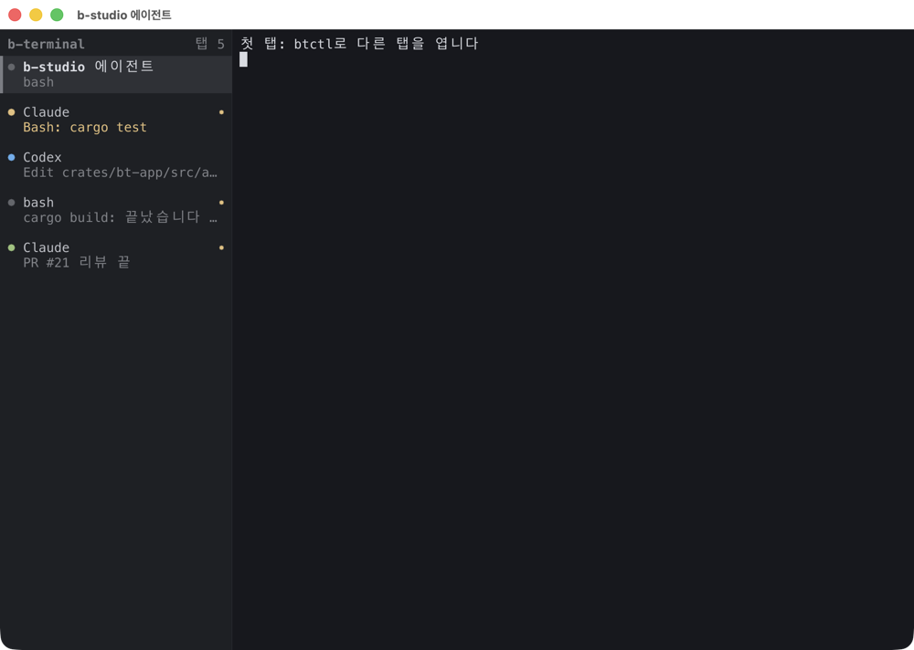

# b-terminal

> AI 코딩 에이전트와 함께 일하려고 만드는 Rust 터미널 에뮬레이터. 탭마다 에이전트가 무엇을 하고 무엇을 기다리는지 사이드바에 보이고, 기다리는 탭은 다른 탭을 보고 있어도 알려 줍니다.

아직 만드는 중입니다. 계획과 진행은 [ROADMAP.md](ROADMAP.md)에 있습니다.


- 에이전트 여러 개를 탭에 띄워 두면, 끝났는지 권한을 묻고 멈췄는지 탭을 하나씩 열어 봐야 압니다.
- b-terminal은 터미널이 그 신호(훅, OSC 알림, 프로세스 종료)를 직접 받아 사이드바에 보입니다.
- [b-studio](https://github.com/dj258255/b-studio)는 검증 관문이고 b-terminal은 그 화면입니다. b-studio 세션의 터미널을 탭으로 엽니다.

## 띄우기

```bash
cargo run --release -p bt-app                 # 로그인 셸
cargo run --release -p bt-app -- -e htop      # 처음 탭에서 다른 프로그램
cargo run --release -p bt-app -- --cwd ~/dev  # 시작 폴더
```

| 키 | 하는 일 |
|---|---|
| Cmd-C / Cmd-V | 고른 글 복사 / 붙여넣기(괄호 붙여넣기 모드면 감싸서) |
| Cmd-= / Cmd-- / Cmd-0 | 글자 크기 키우기 / 줄이기 / 처음대로 |
| Cmd-T / Cmd-W | 새 탭 / 탭 닫기 |
| Cmd-1~9, Cmd-[ / Cmd-] | 탭 옮기기(사이드바를 눌러도 됩니다) |
| Cmd-B | 사이드바 접기·펴기 |
| Cmd-J | 기다리는(권한·질문·끝남) 탭 중 가장 급한 탭으로 |
| Shift-PageUp / PageDown, Cmd-↑ / ↓ | 스크롤백 |
| 마우스 끌기, 두 번·세 번 누르기 | 글자·단어·줄 고르기(앱이 마우스를 쓰면 Shift를 누른 채로) |

## 에이전트와 스크립트에서 쓰기(btctl)

탭 안의 셸에는 `BT_SOCKET`(제어 소켓)과 `BT_TAB_ID`(그 탭 번호)가 들어 있습니다. `btctl`은 이것으로 자기 탭을 찾습니다.

```bash
cargo install --path crates/bt-ctl      # btctl 설치
btctl status waiting-permission --agent claude --activity "Bash: cargo test"
btctl notify "cargo build" "끝났습니다"
btctl new --cwd ~/dev -- claude          # 새 탭에서 claude
btctl list                               # 탭 목록과 상태
btctl read --tab 2                       # 2번 탭 화면을 글로
btctl send --tab 2 --enter "y"           # 2번 탭에 y와 Enter
```



제어 소켓은 같은 사용자만 닿는 폴더(0700)의 소켓(0600)입니다. 자세한 경계는 [SECURITY.md](SECURITY.md)에 있습니다.

## 기여

[CONTRIBUTING.md](CONTRIBUTING.md)와 코딩 에이전트용 [AGENTS.md](AGENTS.md)를 봅니다.

## 라이선스

MIT
