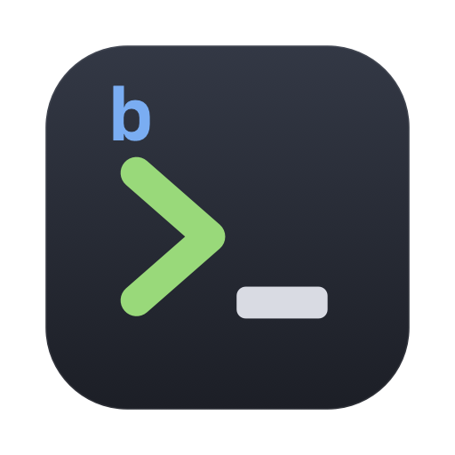

# b-terminal



> Ghostty 같은 순수 Rust 터미널. Ghostty와 같은 설정 문법과 키를 쓰되 Ghostty 없이 혼자 서고, 한글 입력을 고쳐 씁니다. Claude Code·Codex 같은 AI CLI가 쓰는 신호(Shift+Enter, 알림, 진행 표시, 클립보드, 셸 통합)도 빠짐없이 받고, 스크립트가 터미널을 조종하는 `btctl`이 있습니다.

아직 만드는 중입니다. 처음 보신다면 [docs/overview.md](docs/overview.md)부터 읽으세요. 계획과 진행은 [ROADMAP.md](ROADMAP.md)에 있습니다.


- 터미널이 할 일에 집중합니다: PTY, VT 해석, 렌더링, 탭, 한글 IME, 복사·붙여넣기, 설정, 그리고 AI CLI가 쓰는 표준 신호([조사 기록](docs/research/2026-11-06-agentic-terminal.md)).
- AI 에이전트를 다루는 화면(에이전트 목록·상태·사용량)은 [b-studio](https://github.com/dj258255/b-studio)의 일입니다. b-studio는 b-terminal 안에서 도는 프로그램 중 하나입니다(herdr가 Ghostty 안에서 돌듯이). 경계는 [ADR-005](docs/decisions.md#adr-005-b-terminal은-순수-터미널이고-ai-작업-화면은-b-studio가-맡는다)에 적었습니다.

## 설치와 띄우기

macOS 앱으로 묶어 씁니다(Rust 1.87 이상, Xcode 명령줄 도구).

```bash
scripts/bundle-macos.sh --install   # ~/Applications/b-terminal.app (btctl도 앱 안에)
open ~/Applications/b-terminal.app
```

다른 Mac에 나눠 주려면 Developer ID 서명과 공증이 필요합니다: [docs/release-macos.md](docs/release-macos.md).

개발 중에는 `cargo run --release -p bt-app`(인자: `-e <프로그램>`, `--cwd <폴더>`, `--config-file`, `--show-config`, `--list-themes`)로 띄웁니다. 메뉴 막대의 "설정…"이 `~/.config/b-terminal/config`를 예시와 함께 만들어 엽니다.

| 키(macOS 기본) | 하는 일 |
|---|---|
| Cmd-C / Cmd-V | 시스템 클립보드로 복사 / 붙여넣기(괄호 붙여넣기 모드면 감싸서) |
| Cmd-Shift-V(편집 메뉴 "선택 붙여넣기") | 고른 글 붙여넣기. 글을 고르기만 하면 앱 안 선택 클립보드에 담기고(`copy-on-select = primary`, 기본) Cmd-V의 시스템 클립보드는 그대로입니다. 고르면 시스템 클립보드로 복사하려면 `copy-on-select = clipboard` |
| Cmd-= / Cmd-- / Cmd-0 | 지금 창의 글자 크기 |
| Cmd-N / Cmd-T / Cmd-W / Cmd-Opt-W | 새 창 / 새 탭 / 칸 닫기(칸이 하나면 탭) / 탭 닫기 |
| Cmd-1~8, Cmd-9, Cmd-Shift-[ / Cmd-Shift-] | 탭 옮기기(탭 줄을 눌러도 됩니다) |
| Cmd-D / Cmd-Shift-D | 화면을 오른쪽 / 아래로 나누기 |
| Cmd-[ / Cmd-], Cmd-Opt-방향키 | 앞·다음 칸, 그쪽 칸으로(칸을 눌러도 됩니다. 고르지 않은 칸을 누르면 그 칸만 고르고 누름은 프로그램에 보내지 않습니다) |
| Cmd-Ctrl-방향키 / Cmd-Ctrl-= / Cmd-Shift-Enter | 경계 밀기 / 칸 크기 고르게 / 칸 크게 보기 |
| Shift-PageUp / PageDown | 스크롤백 |
| Cmd-↑ / Cmd-↓ | 앞·뒤 프롬프트로(셸 통합) |
| Shift-Enter | Claude Code 등에서 줄바꿈(kitty 키보드 프로토콜. 프로그램이 켰을 때) |
| Cmd-F, Enter / Shift-Enter, Esc | 스크롤백에서 찾기, 위 / 아래 맞은 곳, 닫기(Cmd-G / Cmd-Shift-G도 됨) |
| Cmd-Shift-P | 명령 팔레트(동작을 이름으로 찾아 부름, ↑↓ Enter, Esc) |
| Cmd-K | 화면 지우기 |
| Cmd-Shift-, | 설정 다시 읽기 |
| (전역, 직접 묶음) | 퀵 터미널: `keybind = global:ctrl+backquote=toggle_quick_terminal`이면 어느 앱에서든 Ctrl-` 로 화면 가장자리에서 미끄러져 나오는 창을 보였다 숨김(`quick-terminal-position` 등) |
| Cmd-클릭 | 링크 열기(Cmd를 누르면 URL·OSC 8 링크에 밑줄과 실제 주소가 보입니다. 이미 밑줄 친 글은 이중 밑줄) |
| 마우스 끌기, 두 번·세 번 누르기 | 글자·단어·줄 고르기(앱이 마우스를 쓰면 Shift를 누른 채로). 고른 글은 선택 클립보드에 담깁니다 |
| Option을 누른 채 끌기(Linux는 Ctrl+Alt) | 사각 고르기(누르는 동안 포인터가 십자) |

모든 키는 설정의 `keybind`로 바꿀 수 있습니다([docs/configuration.md](docs/configuration.md#키-묶음)).

## 설정

`~/.config/b-terminal/config`에 Ghostty와 같은 문법으로 씁니다. 글꼴(JetBrains Mono, Nerd Font 기호)과 테마 907개를 앱에 넣어 두어 Ghostty를 깔지 않아도 됩니다(`b-terminal --list-themes`). Ghostty 설정을 옮겨 오려면 `import-ghostty = true`.

```
theme = Dracula
font-family = D2Coding
font-size = 15
cursor-style = bar
window-padding-x = 12
```


지원하는 키와 읽는 순서는 [docs/configuration.md](docs/configuration.md)에 있습니다. `b-terminal --show-config`가 지금 적용된 값을 보입니다.

## 원격 조종(btctl)

kitty·WezTerm의 원격 조종처럼, 스크립트가 터미널의 탭을 열고 글을 넣고 화면을 읽을 수 있습니다. 탭 안의 셸에는 `BT_SOCKET`(제어 소켓)과 `BT_TAB_ID`(그 탭 번호)가 들어 있습니다. 화면을 나누면 칸마다 번호가 따로 있습니다.

```bash
# 앱 안의 btctl: ~/Applications/b-terminal.app/Contents/MacOS/btctl (또는 cargo install --path crates/bt-ctl)
btctl list                               # 탭 목록
btctl new --cwd ~/dev -- htop            # 새 탭에서 htop
btctl new --split right -- tail -f log   # 이 칸을 나눠 오른쪽에서 tail
btctl new --window                       # 새 창
btctl quick                              # 퀵 터미널 보이기·숨기기
btctl send --tab 2 --enter "make test"   # 2번 탭에 글과 Enter
btctl read --tab 2                       # 2번 탭 화면을 글로
btctl read --tab 2 --lines 2000          # 스크롤백까지 2000줄
btctl wait --tab 2 --timeout 30 -- 준비됨  # 그 글이 나올 때까지 기다림
btctl notify "빌드" "끝났습니다"           # 이 탭에 알림
btctl reload-config                      # 설정 다시 읽기
btctl run --tab 2 -- cargo test          # 2번 탭에서 돌리고 끝날 때까지 기다려 출력·종료 코드(셸 통합)
btctl last --tab 2 --json                # 2번 탭에서 마지막으로 끝난 명령
```

제어 소켓은 같은 사용자만 닿는 폴더(0700)의 소켓(0600)입니다. 자세한 경계는 [SECURITY.md](SECURITY.md)에 있습니다.

## AI 코딩 에이전트 CLI와 쓰기

Claude Code·Codex·Gemini CLI 같은 에이전트 CLI는 보통 터미널 프로그램이라 그대로 돕니다. b-terminal이 이런 프로그램에 주는 것은 다음과 같습니다.

- 깜빡임 없는 다시 그리기(동기화 출력, 모드 2026), Shift+Enter 줄바꿈(kitty 키보드 프로토콜), 밝은·어두운 테마 따라가기(모드 2031·OSC 11), 괄호 붙여넣기
- 상태 표시(OSC 7501, Program Status Protocol): 프로그램이 "일하는 중·사용자를 기다림·끝남·실패"를 알리면 탭에 표시합니다. 보고 있지 않은 탭이 기다리거나 끝나면 데스크톱 알림도 냅니다. Claude Code 2.1.295 이상은 설정 없이 보냅니다(tmux 안에서는 보내지 않습니다)

Claude Code는 자기가 아는 터미널(iTerm2·kitty·Ghostty)에서만 스스로 데스크톱 알림을 보내고 링크를 씁니다(2.1.327에서 확인). b-terminal은 그 신호(OSC 777·99·8)를 모두 받으므로, 필요하면 직접 켭니다.

```bash
# Claude Code 자신의 알림을 OSC 777로(~/.claude/settings.json). OSC 7501 알림과 겹칠 수 있습니다
#   { "preferredNotifChannel": "ghostty" }
export FORCE_HYPERLINK=1   # 파일·주소를 OSC 8 링크로 씁니다(Cmd+클릭으로 엶)
```

Codex CLI는 터미널 이름을 보지 않고 OSC 7501을 보내므로 탭 상태는 설정 없이 뜹니다. Codex 자신의 알림은 기본값(`auto`)에서 아는 터미널(Ghostty·iTerm2·kitty·Warp·WezTerm)에만 OSC 9로 가고 b-terminal에는 벨(BEL)로 옵니다. 벨은 `bell-features`를 따라 Dock 아이콘을 튀기고 탭 제목에 🔔를 붙입니다. 알림 글까지 받으려면 직접 켭니다(openai/codex main 코드에서 확인, 2026-11-18).

```toml
# ~/.codex/config.toml. OSC 7501 알림과 겹칠 수 있습니다
[tui]
notification_method = "osc9"
```

Codex는 터미널을 보고 있지 않을 때만 알립니다(포커스 보고, 모드 1004). 알림을 누르면 macOS가 스크립트 편집기를 엽니다([troubleshooting 23번](docs/troubleshooting.md#23-데스크톱-알림을-누르면-b-terminal이-아니라-스크립트-편집기가-열린다)).

b-terminal은 다른 터미널인 척하지 않습니다(`TERM_PROGRAM=b-terminal`). 에이전트 목록이나 상태 모아 보기 같은 작업 화면은 터미널이 아닌 별도 도구의 일로 둡니다.

## 문서

처음 보는 분

- [docs/overview.md](docs/overview.md): b-terminal 한눈에(무엇인가, Ghostty와 같은 점·다른 점, 구조, 보안 모델, 한계)
- [docs/configuration.md](docs/configuration.md): 설정 키와 기본값, 키 묶음
- [docs/troubleshooting.md](docs/troubleshooting.md): 겪은 증상과 해결
- [SECURITY.md](SECURITY.md): 보안 경계와 취약점 제보
- [먼저 볼 ADR](docs/decisions.md#먼저-볼-adr): 설계 결정 기록 중 먼저 읽을 것

개발 기록

- [ROADMAP.md](ROADMAP.md), [CHANGELOG.md](CHANGELOG.md): 판마다의 계획과 변경
- [docs/experiments/](docs/experiments/), [docs/research/](docs/research/): 실험 보고서와 조사 기록
- [CONTRIBUTING.md](CONTRIBUTING.md), [AGENTS.md](AGENTS.md): 기여 방법과 코딩 에이전트(이 저장소를 고치는 도구)용 규칙

## 라이선스

MIT
