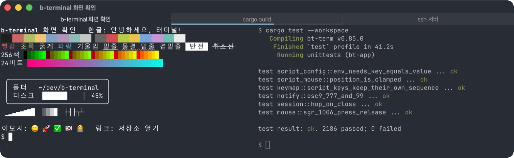
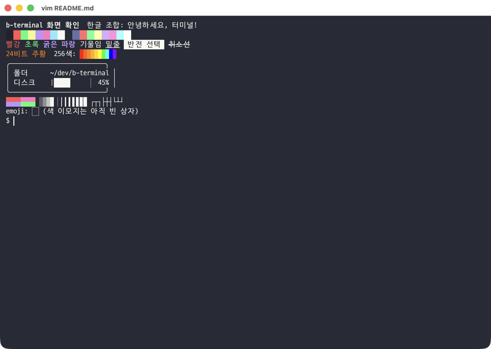

# b-terminal


> AI 에이전트 시대를 위한 나만의 Rust 터미널. Claude Code·Codex 같은 AI CLI가 쓰는 신호(Shift+Enter, 알림, 진행 표시, 클립보드, 셸 통합)를 빠짐없이 받고, 에이전트가 터미널을 조종할 수 있습니다. Ghostty를 본보기로 삼았지만 Ghostty 없이 혼자 섭니다.

아직 만드는 중입니다. 계획과 진행은 [ROADMAP.md](ROADMAP.md)에 있습니다.



- 터미널이 할 일에 집중합니다: PTY, VT 해석, 렌더링, 탭, 한글 IME, 복사·붙여넣기, 설정, 그리고 AI CLI가 쓰는 표준 신호([조사 기록](docs/research/2026-11-06-agentic-terminal.md)).
- AI 에이전트를 다루는 화면(에이전트 목록·상태·사용량)은 [b-studio](https://github.com/dj258255/b-studio)의 일입니다. b-studio는 b-terminal 안에서 도는 프로그램 중 하나입니다(herdr가 Ghostty 안에서 돌듯이). 경계는 [ADR-005](docs/decisions.md#adr-005-b-terminal은-순수-터미널이고-ai-작업-화면은-b-studio가-맡는다)에 적었습니다.

## 설치와 띄우기

macOS 앱으로 묶어 씁니다(Rust 1.85 이상, Xcode 명령줄 도구).

```bash
scripts/bundle-macos.sh --install   # ~/Applications/b-terminal.app (btctl도 앱 안에)
open ~/Applications/b-terminal.app
```

개발 중에는 `cargo run --release -p bt-app`(인자: `-e <프로그램>`, `--cwd <폴더>`, `--config-file`, `--show-config`, `--list-themes`)로 띄웁니다. 메뉴 막대의 "설정…"이 `~/.config/b-terminal/config`를 예시와 함께 만들어 엽니다.

| 키(macOS 기본) | 하는 일 |
|---|---|
| Cmd-C / Cmd-V | 복사 / 붙여넣기(괄호 붙여넣기 모드면 감싸서). 고르기만 해도 복사됩니다(copy-on-select) |
| Cmd-= / Cmd-- / Cmd-0 | 글자 크기 |
| Cmd-T / Cmd-W / Cmd-Opt-W | 새 탭 / 칸 닫기(칸이 하나면 탭) / 탭 닫기 |
| Cmd-1~8, Cmd-9, Cmd-Shift-[ / Cmd-Shift-] | 탭 옮기기(탭 줄을 눌러도 됩니다) |
| Cmd-D / Cmd-Shift-D | 화면을 오른쪽 / 아래로 나누기 |
| Cmd-[ / Cmd-], Cmd-Opt-방향키 | 앞·다음 칸, 그쪽 칸으로(칸을 눌러도 됩니다) |
| Cmd-Ctrl-방향키 / Cmd-Ctrl-= / Cmd-Shift-Enter | 경계 밀기 / 칸 크기 고르게 / 칸 크게 보기 |
| Shift-PageUp / PageDown | 스크롤백 |
| Cmd-↑ / Cmd-↓ | 앞·뒤 프롬프트로(셸 통합) |
| Shift-Enter | Claude Code 등에서 줄바꿈(kitty 키보드 프로토콜. 프로그램이 켰을 때) |
| Cmd-K | 화면 지우기 |
| Cmd-Shift-, | 설정 다시 읽기 |
| Cmd-클릭 | 링크 열기(Cmd를 누르면 URL·OSC 8 링크에 밑줄과 실제 주소가 보입니다) |
| 마우스 끌기, 두 번·세 번 누르기 | 글자·단어·줄 고르기(앱이 마우스를 쓰면 Shift를 누른 채로) |

모든 키는 설정의 `keybind`로 바꿀 수 있습니다([docs/configuration.md](docs/configuration.md#키-묶음)).

## 설정

`~/.config/b-terminal/config`에 Ghostty와 같은 문법으로 씁니다. 글꼴(JetBrains Mono, Nerd Font 기호)과 테마 905개를 앱에 넣어 두어 Ghostty를 깔지 않아도 됩니다(`b-terminal --list-themes`). Ghostty 설정을 옮겨 오려면 `import-ghostty = true`.

```
theme = Dracula
font-family = D2Coding
font-size = 15
cursor-style = bar
window-padding-x = 12
```



지원하는 키와 읽는 순서는 [docs/configuration.md](docs/configuration.md)에 있습니다. `b-terminal --show-config`가 지금 적용된 값을 보입니다.

## 원격 조종(btctl)

kitty·WezTerm의 원격 조종처럼, 스크립트가 터미널의 탭을 열고 글을 넣고 화면을 읽을 수 있습니다. 탭 안의 셸에는 `BT_SOCKET`(제어 소켓)과 `BT_TAB_ID`(그 탭 번호)가 들어 있습니다. 화면을 나누면 칸마다 번호가 따로 있습니다.

```bash
# 앱 안의 btctl: ~/Applications/b-terminal.app/Contents/MacOS/btctl (또는 cargo install --path crates/bt-ctl)
btctl list                               # 탭 목록
btctl new --cwd ~/dev -- htop            # 새 탭에서 htop
btctl new --split right -- tail -f log   # 이 칸을 나눠 오른쪽에서 tail
btctl send --tab 2 --enter "make test"   # 2번 탭에 글과 Enter
btctl read --tab 2                       # 2번 탭 화면을 글로
btctl notify "빌드" "끝났습니다"           # 이 탭에 알림
btctl reload-config                      # 설정 다시 읽기
btctl run --tab 2 -- cargo test          # 2번 탭에서 돌리고 끝날 때까지 기다려 출력·종료 코드(셸 통합)
btctl last --tab 2 --json                # 2번 탭에서 마지막으로 끝난 명령
```

제어 소켓은 같은 사용자만 닿는 폴더(0700)의 소켓(0600)입니다. 자세한 경계는 [SECURITY.md](SECURITY.md)에 있습니다.

## 기여

[CONTRIBUTING.md](CONTRIBUTING.md)와 코딩 에이전트(이 저장소를 고치는 도구)용 [AGENTS.md](AGENTS.md)를 봅니다.

## 라이선스

MIT
